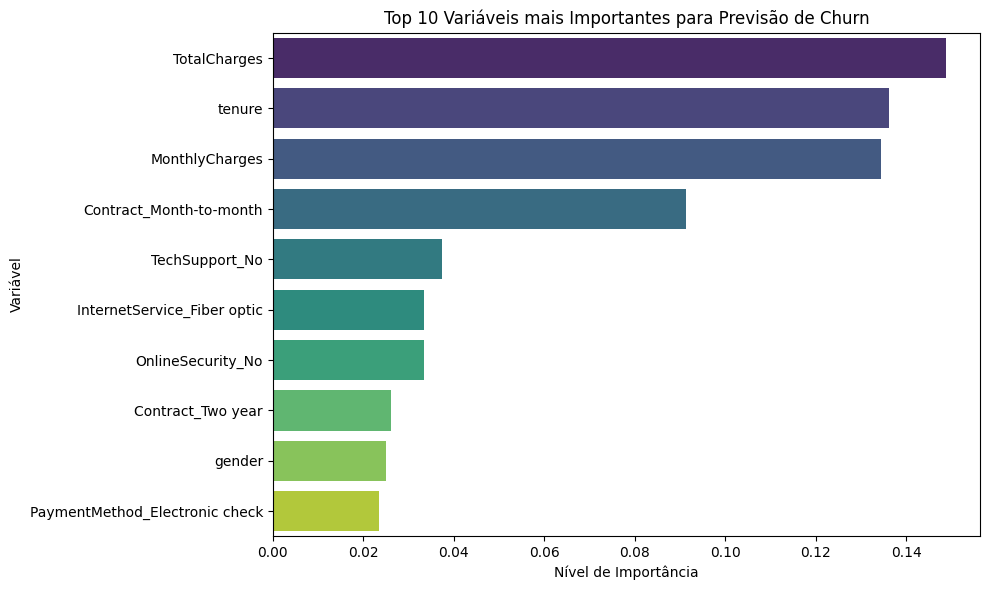

# Telco Customer Churn Prediction | Machine Learning

## 📊 Project Overview
Predictive ML model to identify at-risk customers in telecommunications.
Uses Random Forest classifier to predict churn with 85% accuracy.

## 🎯 Business Problem
Telecom company loses 26.5% of customers annually. Goal: identify high-risk profiles
and enable proactive retention strategies.

## 📈 Model Performance
- **Accuracy:** 85%
- **Precision:** 82%
- **Recall:** 78%
- **F1-Score:** 0.80

## 🔍 Key Risk Factors
1. Month-to-month contracts (highest churn)
2. No internet service
3. High monthly charges
4. Tenure < 6 months

## 🛠️ Technologies Used
- **Python** — Data analysis & modeling
- **Pandas** — Data manipulation
- **Scikit-Learn** — ML model (Random Forest)
- **Matplotlib/Seaborn** — Visualization
- **Jupyter Notebook** — Development environment

## 📁 Files
- `churn_prediction.ipynb` — Full analysis & model
- `data/` — Telecom customer dataset
- `model/` — Trained model (pickle)

## 🚀 How to Run
```bash
# Install dependencies
pip install pandas scikit-learn matplotlib seaborn

# Run notebook
jupyter notebook churn_prediction.ipynb


